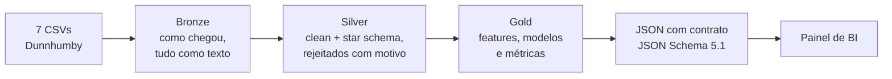

# Lakehouse de varejo: Dunnhumby "The Complete Journey"

Lakehouse medalhão local, em Delta Lake e DuckDB, que transforma os CSVs da base pública [Dunnhumby "The Complete Journey"](https://www.dunnhumby.com/source-files/) nos dados do painel de BI de varejo:

**Painel publicado:** https://caiosantosho2-dotcom.github.io/retail-bi-dashboard/ · [repositório do painel](https://github.com/caiosantosho2-dotcom/retail-bi-dashboard)

A base cobre 2.595.732 linhas de transação de 2.500 domicílios, ao longo de 102 semanas, em uma rede de supermercados dos EUA.

O projeto refaz a arquitetura de dados de um painel que já existia. O critério de pronto era objetivo: a nova arquitetura precisava produzir **os mesmos números** da anterior, e toda diferença precisava de uma explicação registrada.

## Arquitetura



| Camada | O que faz | Onde está |
|---|---|---|
| **Bronze** | Guarda os CSVs sem conversão nem limpeza, com arquivo de origem, data de carga e tabela de controle | `src/bronze/` |
| **Silver `clean`** | Uma tabela por arquivo, com tipos, nomes padronizados e regras de qualidade; o que falha vai para `_rejected` com o motivo | `src/silver/`, seção `silver` do config |
| **Silver `context`** | Star schema: `fact_sales`, `dim_household`, `dim_product`, `dim_store`, `dim_date` | `sql/silver/` |
| **Gold** | `features/` (variáveis dos modelos), `models/` (RFM, risco de pausa, CLV, teste de desconto) e `metrics/` (métricas do painel) | `src/gold/`, `sql/gold/` |
| **Exportação** | Um SQL por arquivo, sem nenhuma conta: só renomeia, arredonda e ordena; cada JSON é validado no contrato | `sql/gold/export/`, `contracts/` |
| **Conferência** | Compara a exportação com o gabarito congelado e recalcula números por SQL próprio a partir da silver | `src/gold/reconcile.py` |

## Decisões principais

O registro completo, com o porquê de cada decisão, está em [`docs/decisoes_arquitetura_lakehouse.md`](docs/decisoes_arquitetura_lakehouse.md). Os códigos abaixo são os usados nele.

- **Delta Lake em todas as camadas (L1):** dá transações, histórico de versões e esquema garantido. Uma tabela Delta é sempre lida como tabela, nunca pelos `.parquet` da pasta, porque arquivos de versões antigas contariam em dobro (F3).
- **Bronze sem tipos e sem limpeza (B6):** conversões e regras ficam na silver, onde são documentadas e testadas. As regras específicas só foram escritas depois do perfil da bronze (S0, S9).
- **Nada some em silêncio (S3):** toda linha rejeitada vai para `_rejected` com o motivo. Rejeição acima de 1% numa tabela para o pipeline.
- **Uma definição por métrica (G4, G12):** cada métrica nasce uma vez na gold, e o painel só lê o resultado.
- **Modelos reaproveitados com versões travadas (G5, G6):** o código estatístico veio de um projeto anterior, adaptado para ler da silver e instalado com as mesmas versões das bibliotecas.
- **Feito para pouca memória (B2, G33):** DuckDB com `memory_limit` e duas threads, e cada etapa pesada num processo próprio.
- **O painel é um consumidor (G43):** a interface entre os dois repositórios são os JSONs com contrato. O manifest de cada exportação registra a versão do contrato e o commit que gerou os dados.
- **Gabarito independente e congelado (G44):** comparar com a pasta viva do painel seria comparar a exportação com ela mesma, porque ela já é uma cópia da exportação. Por isso a comparação usa a tag `v3-rag`, a última versão gerada pela arquitetura anterior.
- **Resultado registrado mesmo quando desfavorável (G45, G48):** na lista de quem acionar no CRM, o modelo ganha da regra simples em 6 de 6 capacidades ao evitar pausas e em 5 de 6 ao proteger valor. Com capacidade de 100 clientes, a regra simples ganha em valor, e a exportação mantém esse resultado sem ajuste.

## Resultados da conferência

| Conferência | Resultado | Como foi medido |
|---|---|---|
| Exportação × gabarito congelado, linha a linha | **54.130 de 54.131 linhas**; 42 de 43 arquivos idênticos byte a byte | `python -m src.gold.reconcile` |
| Diferenças sem explicação | **0**. A única diferença é um texto: a descrição do modelo deixou de dizer "do RAG" (G35) | idem |
| Gabaritos fixos, recalculados da silver por SQL próprio | **20 de 20** | idem |
| Arquivos sem equivalente no gabarito (`faturamento_tempo`, quadrantes, acionamento do CRM) | Iguais ao SQL próprio: 11.144 linhas de `faturamento_tempo`, 607 de quadrantes e 180 de 180 contas de `acionamento_crm` | idem |
| Modelos × projeto original | **80 de 80 números** | Na construção (29 e 30/10/2026), ver abaixo |
| Testes automatizados, com dados sintéticos | **139 passam** | `python -m pytest -q` |

**Sobre o 80 de 80:** essa comparação incluiu segmentos cliente a cliente, AUC, CLV e teste de desconto, e está em [`docs/validacao/fase3a_gold.md`](docs/validacao/fase3a_gold.md) e [`fase3b_gold.md`](docs/validacao/fase3b_gold.md). Ela não faz parte do comando de conferência, porque dependia do projeto original. Os resultados dos modelos continuam cobertos a cada execução pelos arquivos `lab_*.json`, que entram na comparação com o gabarito.

**Limite do que isso prova:** bater com o gabarito mostra que a nova arquitetura reproduz a anterior, não que a anterior estava certa. Por isso os gabaritos fixos e os SQLs próprios refazem as contas por outro caminho. As métricas do CRM medem quem pausou de fato, não quantas pausas uma ação evitaria: a base não tem esse efeito.

Os relatórios de cada fase estão em [`docs/validacao/`](docs/validacao/).

## Como obter os dados

**Este repositório não traz dados.** Baixe a base em uma destas fontes e confira os termos de uso antes de usar ou redistribuir:

- [Kaggle: `frtgnn/dunnhumby-the-complete-journey`](https://www.kaggle.com/datasets/frtgnn/dunnhumby-the-complete-journey), a origem dos CSVs usados aqui;
- [Dunnhumby Source Files](https://www.dunnhumby.com/source-files/), a página oficial da base.

Coloque em `data\raw\` estes 7 arquivos: `transaction_data.csv`, `product.csv`, `hh_demographic.csv`, `campaign_table.csv`, `campaign_desc.csv`, `coupon.csv` e `coupon_redempt.csv`. O `causal_data` fica fora do escopo (B9).

Para conferir o download, `transaction_data` deve ter 2.595.732 linhas, `product` 92.353 e `hh_demographic` 801.

## Como rodar

Testado no Windows com Python 3.14.7. Comandos para PowerShell, a partir da raiz do repositório:

```powershell
# 1. Ambiente isolado com as versões travadas
python -m venv venv
.\venv\Scripts\Activate.ps1
pip install -r requirements.txt

# 2. Configuração local (o config.yaml fica fora do git)
Copy-Item config.example.yaml config.yaml

# 3. Pasta dos CSVs: copie os 7 arquivos para cá
New-Item -ItemType Directory -Force data\raw

# 4. Gabarito congelado: recria o site/data da tag v3-rag do painel, usado só na conferência
git clone --depth 1 --branch v3-rag https://github.com/caiosantosho2-dotcom/retail-bi-dashboard.git "$env:TEMP\painel_v3"
New-Item -ItemType Directory -Force data\gabarito\painel_v3
git -C "$env:TEMP\painel_v3" archive --format=tar -o "$PWD\data\gabarito\painel_v3.tar" v3-rag site/data
tar -xf data\gabarito\painel_v3.tar -C data\gabarito\painel_v3 --strip-components=2
Remove-Item data\gabarito\painel_v3.tar
Remove-Item -Recurse -Force "$env:TEMP\painel_v3"

# 5. Tudo em ordem: bronze, silver, gold, exportação e conferência
python -m src.pipeline
```

O pipeline leva de 3 a 6 minutos, com pico de memória medido em torno de 900 MB. Ele para no primeiro erro com código 1 e mostra o tempo e o status de cada etapa. Sem o gabarito, as etapas até a exportação rodam, mas a conferência falha de propósito em vez de passar.

Os JSONs ficam em `export/painel_v4/`. Outros comandos úteis:

```powershell
python -m pytest -q                                                  # testes; não precisam dos dados reais
python scripts/espiar.py silver/context/sales/fact_sales contagem    # inspeciona uma tabela pelo terminal
```

O notebook [`notebooks/explorando_lakehouse.ipynb`](notebooks/explorando_lakehouse.ipynb) faz um tour pelas camadas com verificações, e [`notebooks/perfil_bronze.ipynb`](notebooks/perfil_bronze.ipynb) traz o perfil que originou as regras da silver.

## O que fica fora do repositório

| Fora do git | Motivo | Como recriar |
|---|---|---|
| `data/raw/` (CSVs) | A base não é redistribuída aqui | [Como obter os dados](#como-obter-os-dados) |
| `data/gabarito/` (gabarito congelado) | É derivado dos dados e já está versionado no repositório do painel | Passo 4 de [Como rodar](#como-rodar) |
| `lake/` (bronze, silver, gold) | Contém a base inteira | `python -m src.pipeline` |
| `export/` (JSONs do painel) | É gerado pelo pipeline | `python -m src.pipeline` |
| `config.yaml`, `venv/` | São locais de cada máquina | Passos 1 e 2 de [Como rodar](#como-rodar) |

As saídas salvas nos notebooks trazem só contagens e agregados, sem linhas individuais da base.

## Estrutura

```
src/        código das camadas (bronze, silver, gold) e src/pipeline.py
sql/        consultas da silver, base comum, métricas e exportação da gold
contracts/  JSON Schema de cada arquivo exportado
tests/      testes com CSVs mínimos e gold sintética
scripts/    espiar.py, para inspecionar tabelas pelo terminal
notebooks/  perfil da bronze e tour do lakehouse
docs/       decisões, specs e relatórios de validação
```
